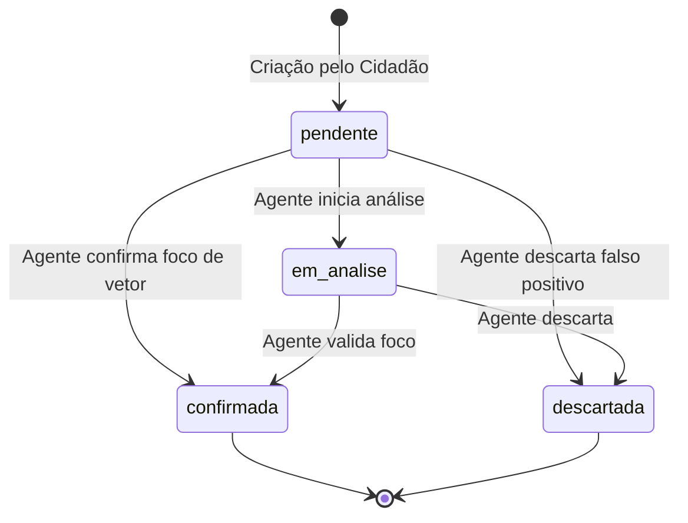

# Arquitetura de Segurança e Regras do Firestore - VetorRisco

Este documento descreve a modelagem de segurança, controle de acesso baseado em papéis (RBAC), conformidade com a LGPD e a esteira de integridade de dados implementada nas regras de segurança do **Cloud Firestore** (`firestore.rules`) para o projeto **VetorRisco** (DSI - UFRPE).

---

## 1. Contexto e Diagnóstico de Vulnerabilidades

As regras de segurança anteriores apresentavam falhas críticas que comprometiam a privacidade dos usuários e a integridade da aplicação.

### Tabela Comparativa de Vulnerabilidades

| Aspecto | Regra Anterior | Risco Identificado | Nova Regra Implementada |
| :--- | :--- | :--- | :--- |
| **Leitura de Usuários (`usuarios`)** | `allow read: if true;` | **Vazamento Crítico de PII (LGPD)**: Qualquer pessoa podia listar dados sensíveis (CPF, e-mail, matrícula, nome). | Restrito ao próprio dono da conta (`isOwner(userId)`) ou Agentes Municipais autenticados (`isAgente()`). |
| **Escrita de Usuários (`usuarios`)** | `allow write: if request.auth != null;` | **Sobrescrita Indevida & Escalação**: Qualquer usuário logado podia alterar dados de terceiros ou se auto-promover para `agente`. | Criação e atualização restritas ao próprio dono (`isOwner(userId)`), com campos imutáveis (`id`, `cpf`, `role`, `dataCriacao`). |
| **Leitura de Denúncias (`denuncias`)** | `allow read: if false;` | **Quebra de Negócio**: Ninguém conseguia visualizar denúncias/focos no mapa. | Leitura liberada para todos os usuários autenticados (`isAuthenticated()`). |
| **Revisão de Denúncias (`denuncias`)** | `allow update: if false;` | **Bloqueio Operacional**: Agentes Municipais não conseguiam auditar ou atualizar status de denúncias. | Atualização restrita a Agentes Municipais (`isAgente()`), com validação de esteira de status e registro de `id_revisor`. |
| **Validação de Payload** | Inexistente em usuários / Frágil em denúncias | Injeção de campos desconhecidos e ataques de tamanho de payload (DoS). | Validação estrita de tipos, regex de e-mail e URL, limite de caracteres e listas restritas de campos (`hasOnly`). |

---

## 2. Matriz de Controle de Acesso Baseado em Papéis (RBAC)

O sistema define dois papéis principais de acesso: **Cidadão** (`cidadao`) e **Agente Municipal de Saúde / Endemias** (`agente`).

```
+---------------------------------------------------------------------------------+
|                                 VETORRISCO RBAC                                 |
+-------------------+--------------------------------+----------------------------+
| Operação          | Cidadão (`cidadao`)            | Agente Municipal (`agente`)|
+-------------------+--------------------------------+----------------------------+
| Ler Usuários      | Apenas seu próprio documento   | Leitura de perfis de apoio |
| Criar Usuário     | Auto-registro (`role: cidadao`)| Definido via admin/claim   |
| Atualizar Usuário | Apenas seus dados (exceto CPF) | Apenas seus dados          |
| Deletar Usuário   | Bloqueado (Auditoria)          | Bloqueado (Auditoria)      |
| Ler Denúncias     | Permitido (Mapa de calor)      | Permitido (Mapa de calor)  |
| Criar Denúncia    | Permitido (vinculado ao UID)   | Permitido (vinculado ao UID|
| Revisar Denúncia  | Bloqueado                      | Permitido (Status/Auditoria|
| Deletar Denúncia  | Bloqueado                      | Bloqueado                  |
+-------------------+--------------------------------+----------------------------+
```

---

## 3. Estrutura e Schemas Validados

### 3.1. Coleção `usuarios/{userId}`
- `id` (string, 1-128 chars): Obrigatório, imutável, idêntico ao `request.auth.uid`.
- `nome` (string, 2-100 chars): Obrigatório.
- `email` (string, formato de e-mail válido): Obrigatório.
- `cpf` (string, 11-14 chars): Obrigatório, imutável.
- `role` (string): Obrigatório, valores permitidos `cidadao` ou `agente`.
- `numero_matricula` (string, até 30 chars): Opcional (para agentes).
- `dataNascimento` (string, `AAAA-MM-DD`): Opcional, editável pelo próprio usuário em Meus Dados Cadastrais.
- `telefone` (string, 10 ou 11 dígitos com DDD): Opcional, editável pelo próprio usuário em Meus Dados Cadastrais.
- `dataCriacao` (timestamp): Obrigatório, imutável.
- `dataAtualizacao` (timestamp): Obrigatório na atualização.

### 3.2. Coleção `denuncias/{denunciaId}`
- `id` (string, 1-128 chars): Obrigatório, imutável.
- `id_denunciador` (string): Obrigatório, imutável, idêntico ao `request.auth.uid`.
- `id_revisor` (string): Obrigatório na auditoria do agente (`request.auth.uid`).
- `urlFoto` (string, URL válida, max 500 chars): Opcional.
- `statusDenuncia` (string): `pendente`, `em_analise`, `confirmada`, `descartada`.
- `localizacao` (latlng/geopoint): Obrigatório, imutável.
- `bairro` (string, 2-100 chars): Obrigatório.
- `dataCriacao` (timestamp): Obrigatório, imutável (`request.time`).

---

## 4. Esteira de Transição de Status das Denúncias

A atualização do campo `statusDenuncia` segue um fluxo unidirecional validado via função `isValidStatusTransition()`:



---

## 5. Como Aplicar as Regras no Firebase Console

1. Acesse o [Firebase Console](https://console.firebase.google.com/).
2. Selecione o projeto **VetorRisco**.
3. No menu lateral esquerdo, navegue até **Build** > **Firestore Database**.
4. Clique na aba **Regras** (*Rules*).
5. Substitua todo o conteúdo do editor pelo código presente no arquivo `firestore.rules`.
6. Clique no botão **Publicar** (*Publish*).
