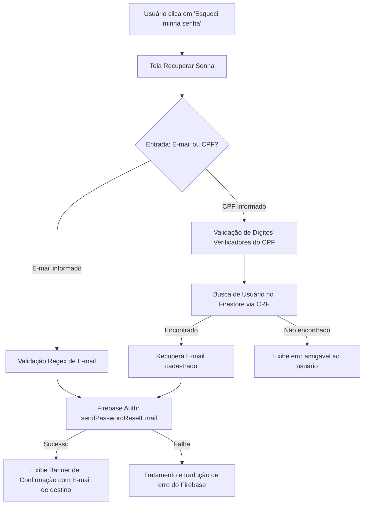

# Fluxo de Recuperação de Acesso - VetorRisco

Este documento descreve a arquitetura, a validação de dados, a integração com o Firebase Auth e a fidelidade visual implementada para a tela de **"Recuperar senha"** (`ForgotPasswordScreen`) no aplicativo **VetorRisco** (DSI - UFRPE).

---

## 1. Identidade Visual e Especificações do Figma

A interface foi implementada em estrita conformidade com as diretrizes do sistema de design do VetorRisco e a tela prototipada no Figma:

- **Topo da Aplicação:**
  - Botão de navegação de retorno (*Back Button*) estilizado com cantos arredondados (`12px`) e borda suave.
  - Alinhamento do logotipo oficial do VetorRisco: ícone da gota (`assets/images/vetor-risco-logo.png`) mantido intacto em sua proporção original, acompanhado da tipografia institucional em Azul Segurança (`#1E3A8A`).
- **Card de Instruções:**
  - Badge superior em caixa alta: `🔒 RECUPERAÇÃO DE ACESSO`.
  - Ilustração centralizada em container circular (`#DBEAFE`) com ícone de reset de credenciais e indicador de verificação.
  - Título em destaque: `Recuperar senha` e descrição orientadora para o usuário.
- **Campo de Entrada Multifuncional:**
  - Label: `E-mail ou CPF *`.
  - Suporte inteligente a digitação: aceita tanto formato de e-mail tradicional quanto CPF com aplicação dinâmica de máscara (`000.000.000-00`).
- **Aviso Institucional de Governança e Privacidade:**
  - Card estilizado informando que os dados estão protegidos conforme as diretrizes da Prefeitura do Recife.
- **Botão de Ação (CTA):**
  - Azul Ação (`#1C64F2`) com texto `Enviar instruções →` e estado de carregamento (*loading spinner*).
- **Rodapé Institucional:**
  - Indicador de status verde (`#10B981`) referenciando o `Canal Oficial de Vigilância Entomológica` e a `Vigilância Ambiental da Prefeitura do Recife`.

---

## 2. Diagrama de Fluxo de Execução

---

## 3. Segurança e Tratamento de Erros

- **Validação com Zod:** Validação síncrona no cliente impedindo submissões vazias ou formatos inválidos.
- **Mensagens em Português:** Mapeamento de erros comuns do Firebase (`auth/user-not-found`, `auth/invalid-email`, `auth/network-request-failed`, etc.).
- **Feedback Transparente:** Ao enviar as instruções, o aplicativo informa ao usuário o e-mail de destino (mesmo quando originado de uma busca por CPF), orientando-o a checar também a pasta de spam.
