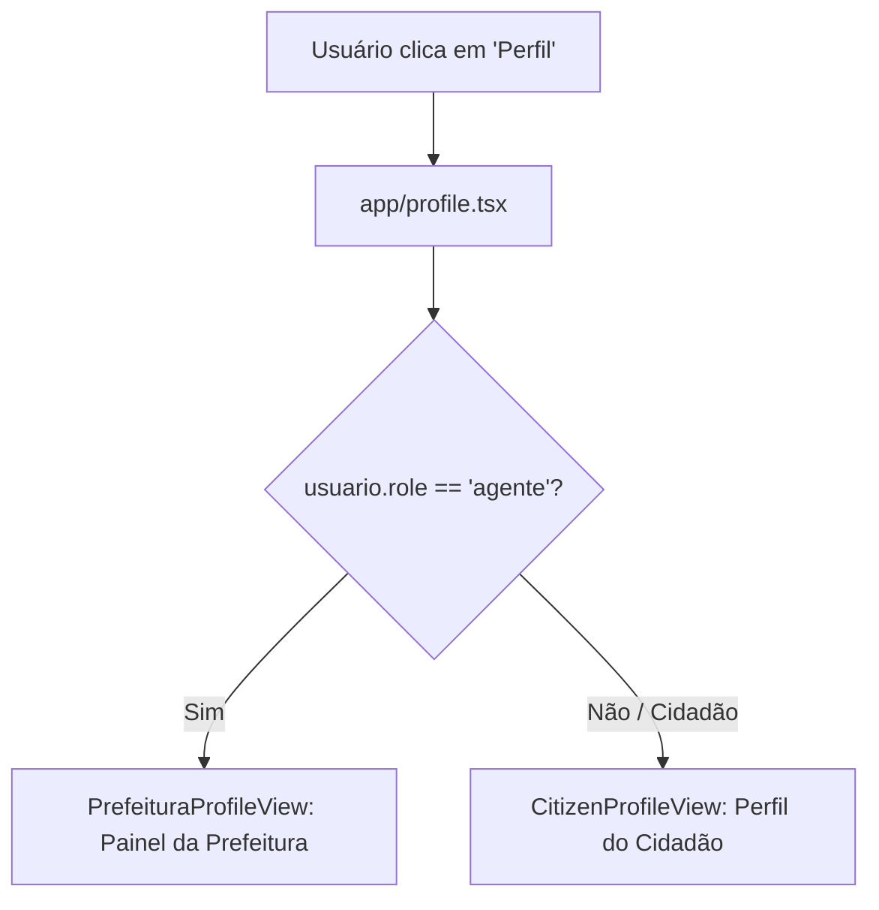

# Painel da Prefeitura e Matriz de Visualização por Papel (RBAC) - VetorRisco

Este documento detalha a implementação do **Painel da Prefeitura** (`PrefeituraProfileView`), a fidelidade ao protótipo do Figma, as regras de controle de acesso baseado em papéis (RBAC) e o chaveamento dinâmico de perfis no aplicativo **VetorRisco** (DSI - UFRPE).

---

## 1. Identidade Visual e Especificações do Figma

A interface do perfil municipal foi construída para atender à rotina operacional dos Agentes Municipais de Saúde e Vigilância Ambiental da Prefeitura do Recife:

- **Cabeçalho Institucional:**
  - Card em destaque com ícone do edifício público municipal (`account-balance`), título **Painel da Prefeitura**, subtítulo identificando a *Vigilância Ambiental* e número de matrícula do agente logado, além de badge de status `● Ativo`.
- **Métricas Operacionais em Tempo Real:**
  - **Abertas:** Quantidade real de denúncias com status `pendente`.
  - **Em análise:** Quantidade real de denúncias com status `em_analise`.
  - **Resolvidas:** Quantidade real de denúncias com status `confirmada` ou `descartada`.
  - As métricas são carregadas da coleção `denuncias` pelo serviço
    `src/services/denuncias-consulta-service.ts`.
- **Score de Priorização Epidemiológica:**
  - Indicador `Tempo Real` e score global de risco `78/100`.
  - Barra de progresso tricolor com segmentação Baixo (verde), Médio (azul) e Alto (vermelho).
  - Cards por distrito sanitário:
    - **Distrito II (Zona Norte):** `88% risco alto` com botão de ação direta `Despachar` equipe de campo.
    - **Distrito IV (Caxangá/Iputinga):** `54% risco` com indicador de prioridade `Média`.
    - **Distrito VI (Boa Viagem):** `18% risco` com indicador de prioridade `Baixa`.
- **Módulos de Gestão (Grid 2x2):**
  - **Dashboard:** Acesso aos indicadores agregados de saúde.
  - **Score & Pesos:** Calibragem dos fatores de risco.
  - **Denúncias:** Navegação para `/denuncias`, com contador baseado nas denúncias abertas.
  - **Mapa Vetorial:** Navegação direta para a visualização cartográfica detalhada da cidade.
- **Rodapé Institucional:**
  - Selo `SUS • Prefeitura do Recife` e iniciativa de apoio à saúde pública.

---

## 2. Controle de Acesso e Alternância Automática de Perfil

Para evitar conflitos de branch e simplificar a navegação solicitada pela equipe, o roteamento da tela de perfil (`app/profile.tsx`) realiza a identificação automática do papel do usuário logado:

### Regras de Segurança (Guarda RBAC):
1. **Chaveamento em `/profile`:** Se um agente municipal fizer login e abrir o menu de perfil, a tela renderizada é imediatamente o **Painel da Prefeitura**. Se for um cidadão comum, ele visualiza o perfil de cidadão.
2. **Rota direta `/prefeitura-profile`:** Conta com guarda síncrona: se um cidadão comum tentar acessar a URL diretamente, ele é redirecionado automaticamente para `/profile`.
3. **Rota `/denuncias`:** Usuários sem o papel `agente` são redirecionados para `/profile`; usuários não autenticados são enviados para `/login`.
4. **Persistência de Sessão:** Botão de encerramento seguro de sessão do agente integrado ao Firebase Auth.

## 3. Consulta e apresentação das denúncias

A tela `/denuncias` utiliza o serviço `listarDenuncias()` para consultar a coleção
`denuncias`. Os registros são validados, convertidos para o tipo `Denuncia` e
ordenados da ocorrência mais recente para a mais antiga.

Cada ocorrência é apresentada em um card com:

- Bairro;
- Status (`Pendente`, `Em análise`, `Confirmada` ou `Descartada`);
- Data de criação;
- Indicação de localização registrada;
- Foto da ocorrência, quando disponível.

A tela também possui estados de carregamento, lista vazia e erro com opção de
tentar novamente. A lista pode ser atualizada manualmente deslizando a tela para
baixo.
