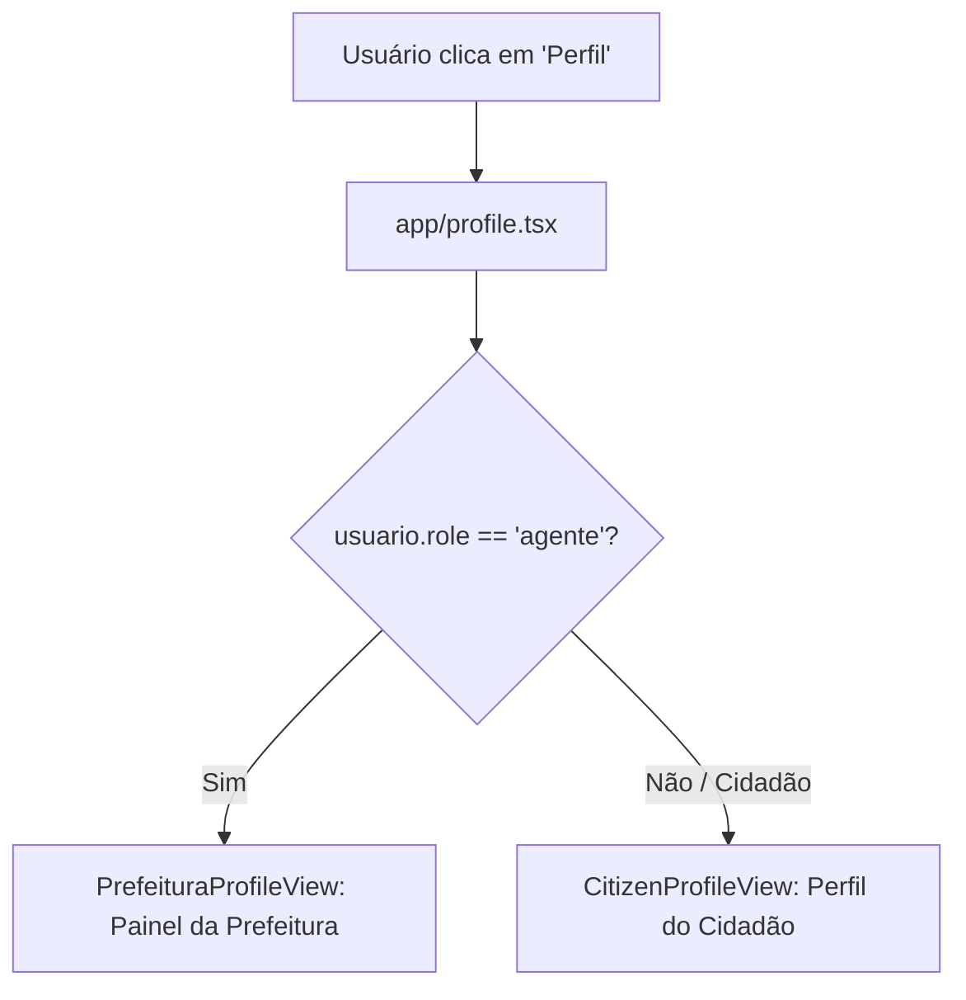

# Painel da Prefeitura e Matriz de Visualização por Papel (RBAC) - VetorRisco

Este documento detalha a implementação do **Painel da Prefeitura** (`PrefeituraProfileView`), a fidelidade ao protótipo do Figma, as regras de controle de acesso baseado em papéis (RBAC) e o chaveamento dinâmico de perfis no aplicativo **VetorRisco** (DSI - UFRPE).

---

## 1. Identidade Visual e Especificações do Figma

A interface do perfil municipal foi construída para atender à rotina operacional dos Agentes Municipais de Saúde e Vigilância Ambiental da Prefeitura do Recife:

- **Cabeçalho Institucional:**
  - Card em destaque com ícone do edifício público municipal (`account-balance`), título **Painel da Prefeitura**, subtítulo identificando a *Vigilância Ambiental* e número de matrícula do agente logado, além de badge de status `● Ativo`.
- **Métricas Operacionais em Tempo Real:**
  - **128 Abertas:** Total de notificações de focos pendentes de inspeção.
  - **43 Em análise:** Focos em averiguação pela equipe de campo.
  - **85 Resolvidas:** Denúncias confirmadas/tratadas ou descartadas.
- **Score de Priorização Epidemiológica:**
  - Indicador `Tempo Real` e score global de risco `78/100`.
  - Barra de progresso tricolor com segmentação Baixo (verde), Médio (azul) e Alto (vermelho).
  - Cards por distrito sanitário:
    - **Distrito II (Zona Norte):** `88% risco alto` com botão de ação direta `Despachar` equipe de campo.
    - **Distrito IV (Caxangá/Iputinga):** `54% risco` com indicador de prioridade `Média`.
    - **Distrito VI (Boa Viagem):** `18% risco` com indicador de prioridade `Baixa`.
- **Módulos de Gestão (Grid 2x2):**
  - **Dashboard:** Acesso aos indicadores agregados de saúde.
  - **Score & Pesos:** Calibragem dos fatores de risco.
  - **Denúncias:** Acesso às ocorrências com contador (`128`).
  - **Mapa Vetorial:** Navegação direta para a visualização cartográfica detalhada da cidade.
- **Rodapé Institucional:**
  - Selo `SUS • Prefeitura do Recife` e iniciativa de apoio à saúde pública.

---

## 2. Controle de Acesso e Alternância Automática de Perfil

Para evitar conflitos de branch e simplificar a navegação solicitada pela equipe, o roteamento da tela de perfil (`app/profile.tsx`) realiza a identificação automática do papel do usuário logado:

### Regras de Segurança (Guarda RBAC):
1. **Chaveamento em `/profile`:** Se um agente municipal fizer login e abrir o menu de perfil, a tela renderizada é imediatamente o **Painel da Prefeitura**. Se for um cidadão comum, ele visualiza o perfil de cidadão.
2. **Rota direta `/prefeitura-profile`:** Conta com guarda síncrona: se um cidadão comum tentar acessar a URL diretamente, ele é redirecionado automaticamente para `/profile`.
3. **Persistência de Sessão:** Botão de encerramento seguro de sessão do agente integrado ao Firebase Auth.
